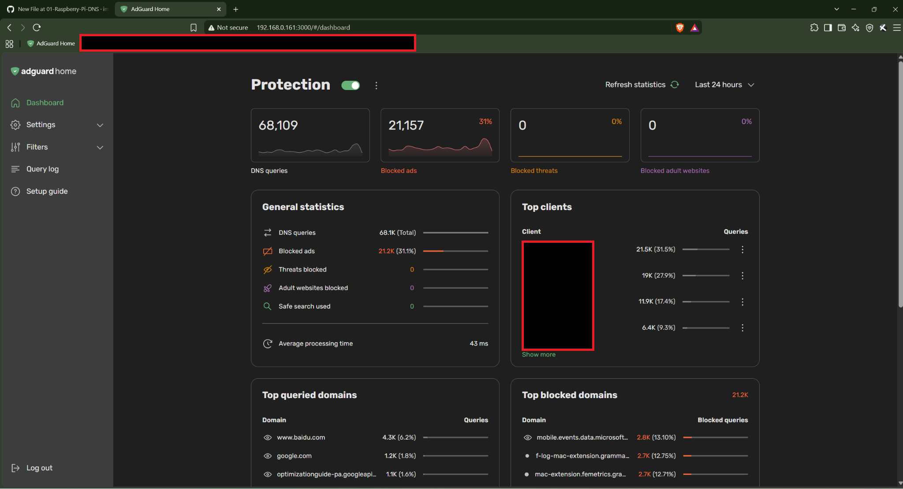
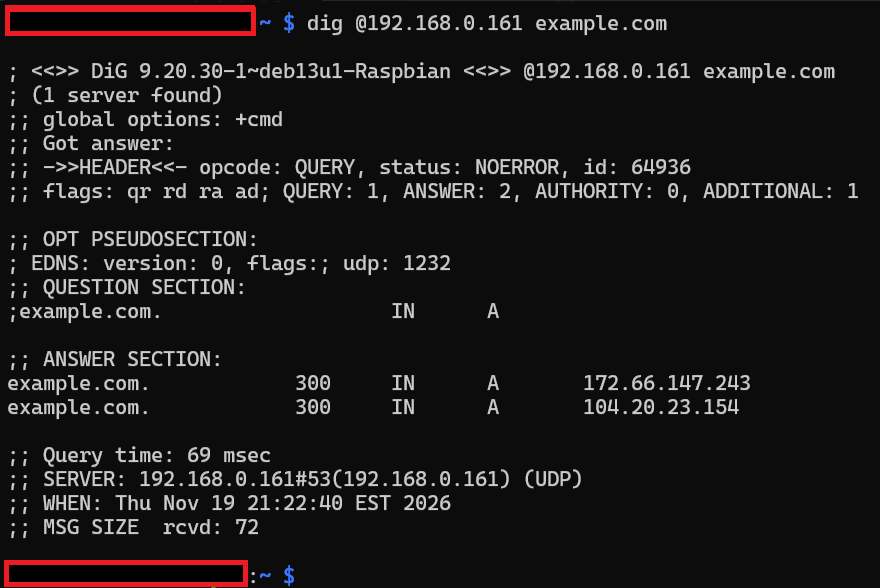
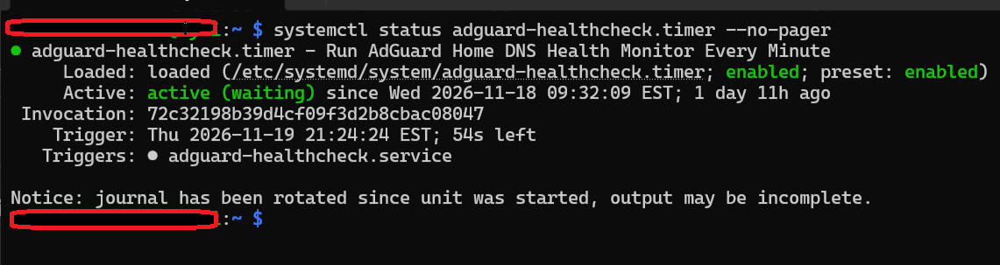

# Raspberry Pi Network-Wide DNS Filtering & Automated Recovery

## Project Overview

I configured a Raspberry Pi Zero running Raspberry Pi OS to act as a network-wide DNS filtering server using AdGuard Home.

The goal of this project was to gain hands-on experience with Linux system administration, DNS configuration, network troubleshooting, firewall management, and service automation.

After experiencing interruptions with DNS availability, I decided to improve the reliability of my setup by developing an automated health-monitoring and recovery solution using Bash scripting and systemd.

This project is part of my personal home lab, where I practice configuring, managing, troubleshooting, and securing network services.

## Hardware and Software

| Component | Description |
|---|---|
| Hardware | Raspberry Pi Zero |
| Operating System | Raspberry Pi OS (Debian 13 / Trixie) |
| DNS Software | AdGuard Home |
| Firewall | UFW |
| Automation | Bash and systemd |
| Remote Administration | SSH |
| Network Router | TP-Link AXE5400 |
| DNS Server IP | 192.168.0.161 |

## Network Architecture

My Raspberry Pi acts as the DNS filtering server for devices on my home network.

The router continues handling normal network routing, while AdGuard Home processes DNS requests, applies filtering rules, and forwards permitted queries to configured upstream DNS resolvers.

**DNS resolution flow:**

```text
Home Network Devices
        |
        | DNS Queries (UDP/TCP Port 53)
        v
Raspberry Pi Zero
192.168.0.161
        |
        v
AdGuard Home
        |
        | DNS Filtering
        v
Upstream DNS Resolvers
        |
        v
DNS Responses Returned to Clients
```

### Network Configuration

- DNS Protocol: UDP and TCP
- DNS Port: 53
- DNS Filtering: AdGuard Home
- Remote Administration: SSH
- Network Type: Private home LAN
- DNS Listening Address: 192.168.0.161

## DNS Server Configuration

I installed and configured AdGuard Home to process DNS queries from devices on my home network.

This allowed me to gain practical experience with:

- DNS resolution and forwarding
- DNS-based filtering rules
- Upstream DNS configuration
- Network-wide DNS administration
- DNS query logging and troubleshooting

AdGuard Home provides a web-based dashboard where I can monitor DNS traffic, review blocked requests, and investigate DNS-related issues.

## DNS Testing and Validation

### DNS Resolution Test

To verify that AdGuard Home was successfully resolving DNS queries, I used the `dig` command to query my Raspberry Pi directly.

**Command:**

```bash
dig @192.168.0.161 example.com
```

**Results:**

| Test | Result |
|---|---|
| DNS Response Status | NOERROR |
| DNS Server | 192.168.0.161 |
| Protocol | UDP / Port 53 |
| Query Response Time | Approximately 50 ms |
| DNS Records Returned | Two IPv4 addresses |

The successful response confirmed that the DNS service was operational and responding to queries through the Raspberry Pi's LAN interface.

### Troubleshooting Localhost DNS Resolution

During testing, I initially attempted to query the DNS service using the localhost address:

```bash
dig @127.0.0.1 example.com
```

This returned a connection refused error.

To investigate the issue, I checked which network interfaces AdGuard Home was listening on.

**Command:**

```bash
sudo ss -lntup | grep ':53'
```

The output showed that AdGuard Home was listening on `192.168.0.161:53` for both TCP and UDP rather than `127.0.0.1:53`.

I then repeated the DNS query using the configured LAN address and successfully resolved the domain.

**Outcome:** Confirmed that the DNS service was functioning correctly and identified why the localhost query failed.

## Automated DNS Health Monitoring

After experiencing DNS interruptions that required manually restarting AdGuard Home through SSH, I developed a Bash health-check script to monitor DNS availability and attempt automatic recovery.

### How the Script Works

1. Checks whether the AdGuard Home systemd service is active.
2. Tests DNS resolution against Google, Cloudflare, and Microsoft.
3. Retries failed DNS checks across three rounds, with five-second intervals.
4. If local DNS fails, checks external DNS resolvers to help determine whether the issue is local.
5. Attempts to restart AdGuard Home when the service is inactive or local DNS fails while external DNS resolution succeeds.
6. Enforces a 15-minute cooldown between restart attempts to prevent repeated restarts.
7. Records monitoring and recovery events using the Linux system logger.

### Why I Implemented This

Because AdGuard Home provides DNS filtering for my home network, interruptions in DNS availability can affect the ability of devices to resolve domain names.

Instead of relying entirely on manual intervention, I wanted to create a solution that could detect service problems and attempt recovery automatically.

This gave me practical experience with Bash scripting, troubleshooting, service monitoring, and infrastructure reliability.

## Systemd Automation

To automate the monitoring process, I created a custom systemd service and timer.

The service executes the Bash health-check script, while the timer schedules recurring checks.

### Configuration

| Component | Configuration |
|---|---|
| Timer | `adguard-healthcheck.timer` |
| Service | `adguard-healthcheck.service` |
| Script | `/usr/local/bin/adguard-healthcheck.sh` |
| Timer Status | Enabled and active |
| Initial Execution | Approximately 2 minutes after boot |
| Recurring Execution | 1 minute after the previous service execution finishes |
| Restart Cooldown | 15 minutes |

The timer uses `OnBootSec=2min` and `OnUnitInactiveSec=1min`, with `AccuracySec=10s`.

The health-check service uses `Type=oneshot`, meaning it executes the script and exits rather than running continuously.

### Verification Commands

**Check timer status:**

```bash
systemctl status adguard-healthcheck.timer --no-pager
```

**Review health-check execution history:**

```bash
sudo journalctl -u adguard-healthcheck.service -n 20 --no-pager
```

**Inspect the service configuration:**

```bash
sudo systemctl cat adguard-healthcheck.service
```

**Inspect the timer configuration:**

```bash
sudo systemctl cat adguard-healthcheck.timer
```

### Testing Results

On November 19, 2026, I verified that the timer was enabled, active, and repeatedly executing the health-check service.

Systemd journal entries showed successful executions between approximately 9:01 PM and 9:08 PM.

These results confirmed that the monitoring automation was running as scheduled.

**Testing limitation:** Although the Bash script includes automatic restart logic, I have not yet documented a complete end-to-end recovery test involving a simulated DNS outage.

## Firewall Configuration

I configured UFW to manage network access to the Raspberry Pi and limit unnecessary inbound connections.

The firewall uses a default-deny policy for incoming traffic while allowing required network services.

### Permitted Services

| Service | Port | Purpose |
|---|---|---|
| DNS | 53 UDP/TCP | DNS resolution |
| SSH | 22 TCP | Remote administration |
| HTTP | 80 TCP | Web access |
| AdGuard Management | 3000 TCP | AdGuard Home management interface |

The configured rules allow these services from the private `192.168.0.0/24` network.

This helped me gain experience with Linux firewall rules, network access control, and securing network services.

## Troubleshooting Experience

Throughout this project, I investigated several DNS-related issues and worked to improve the reliability of the server.

My troubleshooting process included:

- Checking systemd service status and execution history.
- Reviewing AdGuard Home logs.
- Testing DNS resolution using `dig`.
- Checking listening ports and network interfaces.
- Investigating upstream DNS connectivity and TLS-related errors.
- Reviewing UFW firewall rules.
- Developing automated health checks to reduce manual intervention.

One issue involved HTTPS-based upstream DNS connection failures, which led me to investigate DNS-over-HTTPS connectivity and TLS-related errors.

These experiences helped me become more comfortable diagnosing network services and using Linux command-line troubleshooting tools.

## Source Code and Configuration Files

The following files contain the custom monitoring automation used in this project.

- [DNS Health-Check Bash Script](scripts/adguard-healthcheck.sh)
- [Systemd Health-Check Service](systemd/adguard-healthcheck.service)
- [Systemd Health-Check Timer](systemd/adguard-healthcheck.timer)

The Bash script performs DNS health checks and implements restart logic, while the systemd service and timer handle scheduled execution.

## Project Screenshots and Verification

### 1. AdGuard Home Dashboard



This screenshot shows my operational AdGuard Home DNS server processing and filtering network traffic.

During the captured 24-hour period, the server processed **68,109 DNS queries** and blocked **21,157 queries**, representing approximately **31% of DNS traffic**.

### 2. DNS Resolution Verification



I used the `dig` command to verify that my Raspberry Pi successfully resolves DNS queries.

The test returned a `NOERROR` status and two IPv4 addresses, confirming successful DNS resolution through AdGuard Home.

### 3. Automated DNS Health Monitoring



This screenshot verifies that my custom systemd timer is enabled and active.

The timer periodically executes a Bash script that checks DNS availability and includes automatic recovery logic with a 15-minute restart cooldown.

## Skills Demonstrated

- Linux system administration
- DNS server configuration and troubleshooting
- Network-wide DNS filtering
- SSH remote administration
- Bash scripting and automation
- Systemd service and timer management
- UFW firewall configuration
- Linux logging and troubleshooting
- Network service monitoring
- Automated service recovery design
- Technical documentation

## Future Improvements

As I continue developing my home lab, I plan to expand this project with additional monitoring and reliability features.

- Implement centralized monitoring using Zabbix.
- Configure automated notifications for DNS outages.
- Add a secondary DNS server using an HP EliteDesk.
- Improve centralized logging and service monitoring.
- Perform and document an end-to-end automated recovery test.
- Track DNS service availability and recovery performance.

## Project Status

**Operational — Ongoing Improvements**

The Raspberry Pi is currently functioning as a DNS filtering server on my home network.

DNS resolution and scheduled health-check execution have been verified. Additional recovery testing, monitoring, and redundancy improvements are planned as I continue expanding my home lab.
